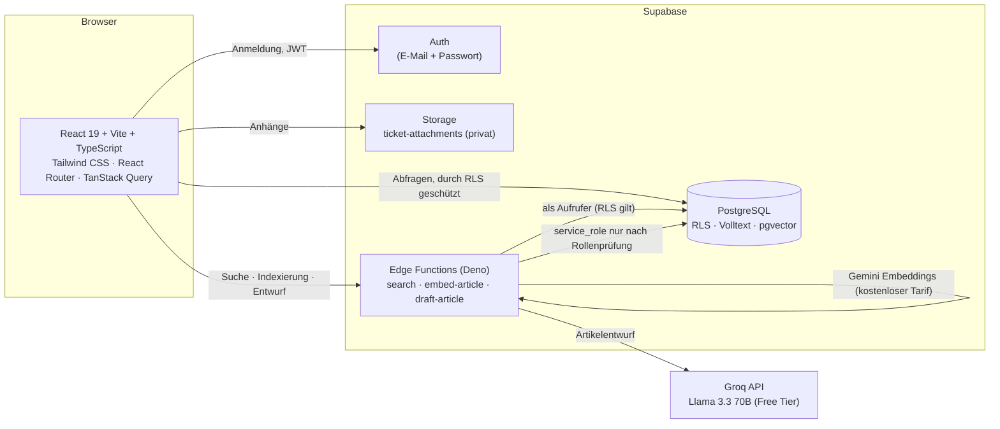

# HelpHub – IT-Selfservice-Portal mit KI-Suche

[](https://github.com/YanislavD/helphub/actions/workflows/ci.yml)

HelpHub ist eine Wissensdatenbank für die IT-Unterstützung eines mittelständischen Unternehmens (Demo-Firma: **Müller Logistik GmbH**, ca. 300 Mitarbeitende). Mitarbeitende beschreiben ihr Problem in eigenen Worten („Ich komme nicht in meinen PC rein“) und finden per **KI-gestützter Suche** die passende Anleitung. Hilft der Artikel nicht, erstellen sie mit einem Klick ein Ticket – der Suchtext ist dann schon eingetragen. IT-Agents schreiben Artikel (auf Wunsch mit KI-Entwurf) und sehen, wonach gesucht wird und wo noch Artikel fehlen.

> Portfolio-Projekt. Die Firma, alle Namen, Adressen und Telefonnummern sind frei erfunden.

## Inhalt

- [Funktionen](#funktionen)
- [Screenshots](#screenshots)
- [Architektur](#architektur)
- [Wie die Suche funktioniert](#wie-die-suche-funktioniert)
- [Sicherheit](#sicherheit)
- [Demo-Zugänge](#demo-zugänge)
- [Lokal starten](#lokal-starten)
- [Tests und CI](#tests-und-ci)
- [Projektstruktur](#projektstruktur)
- [Bekannte Grenzen und Ausblick](#bekannte-grenzen-und-ausblick)

## Funktionen

| Rolle                      | Was geht                                                                                                                                                                                                                                                                    |
| -------------------------- | --------------------------------------------------------------------------------------------------------------------------------------------------------------------------------------------------------------------------------------------------------------------------- |
| **Mitarbeitende** (`user`) | Suchen in normaler Sprache · Artikel lesen (Inhaltsverzeichnis, ähnliche Artikel, Lesezeit) · „War dieser Artikel hilfreich?“ mit Kommentar · Ticket erstellen (mit Screenshot/PDF) · „Meine Tickets“ · Hell/Dunkel-Design                                                  |
| **IT-Agents** (`agent`)    | Zusätzlich: Artikel schreiben und bearbeiten (Markdown mit Live-Vorschau, Tags, Entwurf/Veröffentlicht) · **KI-Assistent**: aus einer formlosen Lösungsbeschreibung entsteht ein Artikelentwurf · Dashboard mit Suchstatistik, fehlenden Artikeln, Bewertungen und Aufrufen |
| **Admins** (`admin`)       | Zusätzlich: Suchindex neu aufbauen · Seite „Suchqualität“ (30 Testfragen gegen die echte Suche) · Kategorien verwalten (anlegen, umbenennen, Symbol wählen, Reihenfolge ändern, löschen) · Nutzer und Rollen verwalten (der letzte Admin kann nicht entfernt werden)        |

Alle Texte der Oberfläche sind auf Deutsch, Code und Kommentare auf Englisch. Das Design ist dunkel, responsiv und in einem Design-System mit CSS-Variablen definiert (`src/index.css`).

## Screenshots

<!-- Dateien nach docs/screenshots/ legen (Liste: docs/screenshots/README.md), dann die Kommentarzeichen entfernen. -->
<!--
| Startseite | Suchergebnisse |
| --- | --- |
|  |  |

| Artikel | Ticket erstellen |
| --- | --- |
|  |  |

| Editor mit KI-Assistent | Dashboard |
| --- | --- |
|  |  |
-->

_Screenshots werden ergänzt._ Bis dahin: [Demo-Zugänge](#demo-zugänge) und [Lokal starten](#lokal-starten).

## Architektur



**Stack:** React 19, Vite, TypeScript (strict), Tailwind CSS v4, React Router, TanStack Query · Supabase (Postgres, Auth, Storage, Edge Functions) · pgvector · Vitest + Testing Library · GitHub Actions.

Alles läuft auf kostenlosen Angeboten – es gibt keine bezahlten API-Schlüssel.

## Wie die Suche funktioniert

Die Suche kombiniert zwei Verfahren und mischt ihre Ergebnisse:

1. **Stichwortsuche (PostgreSQL Volltext, Konfiguration `german`).** Wörter werden auf ihren Stamm reduziert („Drucker“, „Druckern“ → `druck`), Füllwörter fallen weg, der Titel zählt mehr als der Text (Gewichtung A > B > C). Ein GIN-Index macht sie schnell. Wörter, die in über 30 % der Artikel vorkommen, werden ignoriert.
2. **Semantische Suche (pgvector).** Jeder Artikel wird in Abschnitte (~900 Zeichen) zerlegt; das mehrsprachige Modell `gemini-embedding-001` (kostenloser Tarif der Google-Gemini-API, aufgerufen aus der Edge Function) macht aus jedem Abschnitt einen Vektor mit 384 Zahlen. Die Frage wird genauso umgerechnet, die ähnlichsten Abschnitte findet ein HNSW-Index (Kosinus-Ähnlichkeit). So findet „Ich komme nicht in meinen PC rein“ auch „Windows-Passwort zurücksetzen“, ohne dass ein Wort übereinstimmt.
3. **Reciprocal Rank Fusion.** Beide Rangfolgen werden nur über ihre _Positionen_ verbunden (`1/(60 + Rang)`), nicht über ihre unvergleichbaren Punktzahlen.

Die Relevanz wird bewusst als Stufe angezeigt („Sehr relevant“, „Relevant“, „Möglicherweise relevant“) statt als Prozentwert: Die Ähnlichkeitswerte sind Rohwerte eines Modells, keine Wahrscheinlichkeiten. Ist der beste Treffer schwach, erscheint der Hinweis „Keine eindeutige Antwort gefunden“ samt Ticket-Angebot. Fällt die KI-Suche aus, greift die Stichwortsuche als Rückfall.

### Gemessene Qualität

Die Admin-Seite **Suchqualität** führt 30 Testfragen gegen die echte Suche aus (78 Artikel):

| Messwert                                                                 | Ergebnis |
| ------------------------------------------------------------------------ | -------- |
| Richtiger Artikel auf Platz 1 (25 Fragen mit Antwort)                    | 24 / 25  |
| Richtiger Artikel in den Top 3                                           | 25 / 25  |
| Fragen ohne Antwort („Kaffeemaschine kaputt“ u. a.) ohne starken Treffer | 5 / 5    |

Die Schwelle `STRONG_SIMILARITY` (`src/features/search/relevance.ts`) ist an diesen Fragen kalibriert und sollte bei mehr Artikeln erneut geprüft werden.

**Warum Gemini statt `gte-small`?** Zuerst lief das eingebaute Modell `gte-small`. Es ist vor allem auf Englisch trainiert: Bei deutschem Text lagen alle Ähnlichkeiten eng zusammen (ca. 0,80–0,94). Mit 78 statt 27 Artikeln fiel es deutlich ab (17 / 25 auf Platz 1, 3 / 5 bei Fragen ohne Antwort). Der Wechsel auf ein mehrsprachiges Modell brachte den Sprung auf 24 / 25 und 5 / 5. Die Testseite hat den Wechsel messbar begründet – deshalb ist sie Teil des Projekts.

## Sicherheit

- **Row Level Security auf allen Tabellen.** Mitarbeitende sehen nur veröffentlichte Artikel sowie eigene Stimmen, Suchen und Tickets; Agents sehen und bearbeiten alle Artikel; nur Admins ändern Rollen und Kategorien. Eine Rolle kann man sich nicht selbst geben, und ein Datenbank-Trigger verhindert, dass der letzte Admin entfernt wird. Der Route-Guard im Frontend ist nur Komfort – die echte Absicherung liegt in der Datenbank.
- **`service_role`-Schlüssel nie im Frontend.** Er wird nur in Edge Functions benutzt, und erst nachdem Token und Rolle des Aufrufers geprüft wurden. Die Funktionen prüfen den Aufrufer selbst (`verify_jwt = false`, weil die Plattform-Prüfung die neuen API-Schlüssel nicht versteht).
- **Statistik-Funktionen** (`SECURITY DEFINER`) prüfen als Erstes `is_staff()`; Mitarbeitende bekommen einen Fehler.
- **Dateianhänge** liegen in einem privaten Bucket unter `<user-id>/<ticket-id>/…`; Storage-Richtlinien erlauben nur den eigenen Ordner (Agents lesen alle). Größe (10 MB) und Dateitypen werden im Browser _und_ von Storage geprüft.
- **XSS:** Artikel-Markdown wird ohne rohes HTML gerendert (per Test abgesichert). **Open Redirect:** `?redirect=` akzeptiert nur Pfade der eigenen App (per Test abgesichert).
- **KI-Entwürfe:** Der API-Schlüssel liegt als Edge-Function-Secret. Entwürfe werden nie automatisch veröffentlicht; die KI darf nichts erfinden und schreibt Lücken in eine Prüfliste für den Autor.

Jede Richtlinie hat einen SQL-Test in `supabase/tests/` (siehe [Tests](#tests-und-ci)).

## Demo-Zugänge

Nach dem Einspielen von `supabase/seed.sql` gibt es diese Konten (alle mit demselben Passwort):

| Rolle         | E-Mail                                     | Passwort             |
| ------------- | ------------------------------------------ | -------------------- |
| Mitarbeiterin | `anna.weber@mueller-logistik.example`      | `HelpHub-Demo-2026!` |
| Mitarbeiter   | `markus.schulz@mueller-logistik.example`   | `HelpHub-Demo-2026!` |
| Mitarbeiter   | `tim.becker@mueller-logistik.example`      | `HelpHub-Demo-2026!` |
| IT-Agent      | `jonas.keller@mueller-logistik.example`    | `HelpHub-Demo-2026!` |
| Admin         | `sabine.hoffmann@mueller-logistik.example` | `HelpHub-Demo-2026!` |

> **Achtung:** Das Passwort ist öffentlich. Nutze diese Konten nur lokal oder für private Demos. Bevor eine Instanz öffentlich erreichbar ist, entferne sie (`delete from auth.users where email like '%@mueller-logistik.example';`) oder vergib neue Passwörter.

## Lokal starten

**Voraussetzungen:** Node.js 24, ein (kostenloses) [Supabase](https://supabase.com)-Projekt. Optional: ein kostenloser [Groq](https://console.groq.com)-Schlüssel für den KI-Assistenten.

```bash
git clone https://github.com/YanislavD/helphub.git
cd helphub
npm install
```

1. **Umgebungsvariablen:** `.env.example` nach `.env.local` kopieren und `VITE_SUPABASE_URL` sowie den öffentlichen Schlüssel (`VITE_SUPABASE_ANON_KEY`, „publishable key“) eintragen. Der `service_role`-Schlüssel gehört **nicht** hierher.
2. **Datenbank anlegen** (Migrationen in `supabase/migrations/`):

   ```bash
   npx supabase login
   npx supabase link --project-ref <deine-project-ref>
   npx supabase db push --remote
   ```

   > Mit der Supabase-CLI v3 zielt `db push` ohne `--remote` auf eine _lokale_ Docker-Datenbank.

3. **Demo-Daten:** Inhalt von `supabase/seed.sql` im SQL-Editor von Supabase ausführen (Konten, 27 Artikel, Stimmen, Tickets), danach die beiden Dateien in `supabase/seed/` (51 weitere Artikel). Optional `supabase/seed_demo_activity.sql` für ein gefülltes Dashboard.
4. **Edge Functions** bereitstellen:

   ```bash
   npx supabase functions deploy --use-api
   # Suche: kostenloser Schlüssel von aistudio.google.com/apikey (bleibt auf dem Server)
   npx supabase secrets set GEMINI_API_KEY=<dein-schluessel>
   # nur für den KI-Assistenten (Schlüssel von console.groq.com, bleibt auf dem Server):
   npx supabase secrets set GROQ_API_KEY=<dein-schluessel>
   ```

5. **Starten:** `npm run dev` und <http://localhost:5173> öffnen. Als Admin anmelden und unter _Artikel → Suchindex neu aufbauen_ die Vektoren für die Demo-Artikel erzeugen (ohne diesen Schritt greift nur die Stichwortsuche).

Ohne Seed: Konto registrieren, dann in der Tabelle `profiles` die Spalte `role` des Kontos auf `admin` setzen – so wird man erster Admin. Alle weiteren Rollen vergibt man danach unter _Nutzer & Rollen_.

### Skripte

| Befehl                                    | Zweck                            |
| ----------------------------------------- | -------------------------------- |
| `npm run dev`                             | Entwicklungsserver               |
| `npm run build`                           | Typprüfung und Produktions-Build |
| `npm test` / `npm run test:watch`         | Tests (Vitest)                   |
| `npm run lint` / `npm run typecheck`      | ESLint / TypeScript              |
| `npm run format` / `npm run format:check` | Prettier                         |

## Tests und CI

- **117 Vitest-Tests** (17 Dateien): reine Logik (Slugs, Abschnitte für Embeddings, Relevanz-Stufen, Inhaltsverzeichnis, Dateinamen, sichere Weiterleitung, Parser für KI-Antworten, Fehlertexte) und Komponenten mit Testing Library (Anmelde- und Registrierformular, Rollen-Guard, Tag-Eingabe, Artikelkarte, Markdown-Rendering inkl. XSS-Schutz, Design-Umschalter).
- **SQL-Regressionstests** in `supabase/tests/` – im SQL-Editor ausführen; jeder legt Testdaten in einer Transaktion an und rollt sie am Ende zurück (Erfolg: `NOTICE: ALL … CHECKS PASSED`):
  `rls_policies.sql` (Rollen und Rechte), `search.sql` (Volltext, Suchprotokoll), `semantic_search.sql` (Vektorsuche mit synthetischen Vektoren), `feedback_tickets.sql` (Stimmen, Tickets, Storage), `dashboard.sql` (Zugriff und Kennzahlen), `admin_tools.sql` (Nutzerliste, Kategorien, Schutz des letzten Admins).
- **GitHub Actions** (`.github/workflows/ci.yml`) führt bei jedem Push und Pull Request Prettier, ESLint, TypeScript, Tests und den Build aus.

## Projektstruktur

```
src/
  app/            Router, Provider
  components/     wiederverwendbare UI (Button, Badge, TextField, Dialog, Toast …)
  features/
    auth/         Anmeldung, Rollen, Route-Guard
    articles/     Artikel-API, Editor, KI-Assistent, Indexierung
    search/       Suche, Relevanz, Testfragen
    feedback/     „War dieser Artikel hilfreich?“
    tickets/      Ticket-Dialog, Anhänge
    dashboard/    Kennzahlen, Diagramm
  layouts/        Mitarbeiter-Layout (oben) und Agent-Layout (Seitenleiste)
  lib/            Supabase-Client, Hilfsfunktionen
  pages/          Seiten
supabase/
  migrations/     Datenbankschema, RLS, Funktionen (versioniert)
  functions/      Edge Functions: search, embed-article, draft-article
  tests/          SQL-Regressionstests
  seed.sql        Demo-Daten
```

## Bekannte Grenzen und Ausblick

- **Embedding-Modell:** Die Suche hängt vom kostenlosen Tarif der Gemini-API ab (Ratenlimit). Bei Ausfall oder fehlendem Schlüssel greift die Stichwortsuche. Wechselt man das Modell, muss der Suchindex neu aufgebaut werden.
- **Tickets** werden in einer eigenen Tabelle gespeichert, bis eine separate Ticket-Anwendung angebunden ist (Idee: „Ticket in Artikel umwandeln“). Es gibt keine E-Mail-Benachrichtigungen.
- **KI-Entwürfe** nutzen den kostenlosen Tarif von Groq: begrenztes Kontingent, und Eingaben werden an einen Drittanbieter gesendet. Für echte Firmendaten ist ein eigener Anbieter oder ein selbst betriebenes Modell nötig. Entwürfe müssen immer von Menschen geprüft werden.
- **Deployment** (z. B. Netlify) ist noch offen; die Konfiguration ist dafür vorbereitet (Umgebungsvariablen, statischer Build).
